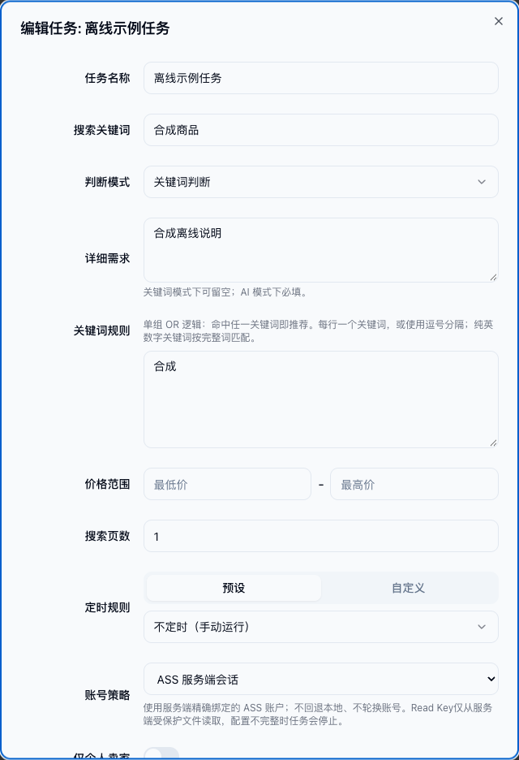

# ASS 账号来源

Goofish是现有ASS通用浏览器会话的普通消费者，不增加Goofish专用服务端、协议、采集扩展或任务回调。功能已随PR #8合入`master`，并于2026-10-19经用户批准以固定digest手动部署到NAS；独立Read Key、正式HTTPS页面配置和原参数常规任务运行结果见[首次交付记录](records/ass-account-source-20261019.md)。自动NAS交付通道尚未启用，不把镜像发布等同于自动部署成功。

## 选择来源

任务的账号策略新增 **ASS 服务端会话**（`account_strategy: "ass"`）。现有auto/fixed/rotate默认不变，配置ASS环境不会自动切旧任务；ASS模式不选择本地文件或账号池，不轮换账号，不以本地Cookie兜底。API创建/更新/关键词任务生成、SQLite持久化、CLI、父子进程与前端支持同一值。

新增的是现有SQLite TEXT列的一个值，无新表/列/迁移；旧任务不改写。PATCH只改页数等普通字段、或清空无关本地文件字段时，必须保留ASS来源；显式改策略才切回本地。旧程序会把未知策略归一为auto，**不能盲降级**：回退前先禁用ASS任务并核对配置/数据兼容性，不能借回退绕过来源或暂停。



截图只含合成任务和本地mock API，无真实账号或提交动作。这里选择服务端固定的一项，不提供浏览器读取Key/完整会话的API，也不伪装成可自动发现ASS账户列表。

## 服务端配置与授权

部署环境注入如下非凭据引用，示例亦见`.env.example`：

```dotenv
ASS_ORIGIN=https://ass.example.com:18443
ASS_READ_KEY_FILE=/run/secrets/ass-read-key
ASS_TENANT_ID=11111111-1111-4111-8111-111111111111
ASS_SECRET_ID=22222222-2222-4222-8222-222222222222
ASS_SECRET_NAME=session.goofish.main
ASS_SITE_ID=goofish
ASS_ACCOUNT_ID=main
ASS_ALLOW_MIXED=false
ASS_UNSPECIFIED_SAMESITE=reject
```

- 由用户另行批准ASS管理员签发/配置Goofish独立Read Key，仅`rest`，scope仅metadata/read + value/read，**精确授权这一个会话UUID**，不授租户、不复用MoviePilot或采集Key。当前消费者要求active_grant_count=1。
- Key不填进.env、任务、前端、URL或命令参数；仅从容器内受保护普通文件读取，推荐只读单文件挂载、0400（接受0600），owner为root/运行用户，拒绝链接/特殊文件/组其他权限/执行位。应用不自动签发/轮换Key或部署挂载，需管理员单独配置；本次已批准的NAS配置见交付记录。使用POSIX文件保护，不在无法确认NOFOLLOW的平台静默弱化检查。
- 名称+UUID、tenant、site/account、来源共同固定；当前仅消费`https://www.goofish.com`单来源包，多来源或旧Cookie协议拒绝，不能把其他网站凭据混入。新建/删除重建同名项不能自动扩大授权。
- `ASS_ALLOW_MIXED=true`是明确接受新Cookie+旧页面组的代际风险；默认完整投影拒绝mixed。即使同Profile/producer或账号标签，也不证明同一个真实登录用户，切换来源/账号前要停任务、人工验证并评估原结果/失败状态，不自动清空业务数据。
- Chrome的未指定SameSite在Playwright不能无损表达，默认报`ass_cookie_samesite_unrepresentable`，**不丢Cookie或静默改Lax**；只有用户明确接受语义归一后设置`ASS_UNSPECIFIED_SAMESITE=lax`。SameSite=None必须Secure；分区/非store0/重复物理身份等拒绝。

## 读取与恢复

每次浏览器尝试前重新打开Key文件、access-status → metadata → value → metadata；固定Key ID/租户/单项授权、名称/UUID与前后版本，期限/撤销/权限/429/重定向/竞态失败立即停止，不盲目重试API、不读磁盘或旧缓存。HTTPS校验证书、禁跳转、trust_env=False，不承诺通过环境代理或.netrc。整体20秒期限，metadata/status 20KiB、value外层2MiB以容纳JSON转义，内层仍256KiB UTF8。

严格接受`ass-browser-session` schema1完整、schema2 complete/mixed；验证全部Cookie/页面/env/storage/安全headers、数量和字节边界、规范身份与时间。complete的页面时间/ID与当前观察/快照一致；mixed保留旧页面时间/基线，不能冒充当前页面。未来时钟异常拒绝；旧观察只给固定提示，不重标时间或推断已退出，实际登录仍由网站决定。

- Cookie全作用域/路径/hostOnly与domain区别/HttpOnly/Secure/session/expiry保留，过期项不复活，物理重复拒绝；没有可用Cookie时停止。
- `storage_state`只用内存dict恢复Cookie+localStorage，从不写原始快照/Key到本地state或临时文件。
- 每个新任务主/详情/卖家标签页，在任何网站脚本执行前，通过**本地route应答的固定同源空白页**初始化一次sessionStorage。不会向网站发送种子页探针，referrer-policy为no-referrer。值经JSON.parse作为纯数据处理，包含`__proto__`也不当代码；随后移除route。不是每次导航反复执行的init脚本，因此页面删除/更新的键不会在重载时被旧快照复活，也不跨来源灌入存储。
- 环境只沿用原消费范围内可表示的UA/locale/timezone/屏幕/触控字段与安全headers；不执行ASS下发代码、任意Authorization/Cookie header回放、保活/额外登录探测。ASS路径不叠加原本地模式强制移动设备的navigator伪装脚本，也不沿用disable-web-security/禁用站点隔离开关；不把桌面快照伪装成完全同一原Profile。
- 部分浏览器环境本来无法完整复制，完整/混合快照都不保证闲鱼业务登录和风控通过。每次任务/尝试重新鉴权；撤销不追溯终止已完成读取后正在执行的关联浏览器请求，下一次读取会拒绝。

## 暂停与隐私

父进程和子进程ASS路径均不给FailureGuard本地cookie_path，避免本地mtime、新snapshot或刷新观察时间解除原网站暂停。显式SESSION_EXPIRED/USER_NOT_LOGIN/USER_VALIDATE返回不能当作成功空结果，详情中的登录/风控异常也不得被单商品异常捕获后继续。父进程无法确认任务来源时也不凭本地文件恢复。按原冷却期限处理网站故障，登录/风险检测不轮换账号或代理重试，不增加解锁或绕过逻辑。

ASS不可达/Key失效/权限或内容错误，只输出固定`ass_*`来源错误，本次停止且不增加网站登录/风控失败计数，不把它记成网站成功。Playwright配置/存储异常与ASS路径任务异常脱敏，关闭原始响应debug输出；Cookie/Key/env/storage/底层异常不进入日志、通知、任务/API/MCP结果。仅在本次受信进程/浏览器内存持有，进程退出码或任务停止不等于凭据/业务验证成功。

## 验证与发布边界

原124项非live回归通过，最终全套 **195 passed / 3 live deselected**；另在临时工作目录、禁读dotenv、临时默认数据库/运行目录和Python外网DNS阻断下再次195通过，无外部解析尝试。原生Chrome测试通过而非skip；前端TypeScript/Vite及本地mock UI选择截图通过。新增测试覆盖协议、完整/混合/归一化显式门禁、118331bytes与256KiB边界、身份/版本竞态/撤销、TLS选项/无跳转/额度、Key文件、父子暂停、无本地fallback、CLI/API/SQLite roundtrip与PATCH不切源；真实临时Chrome的业务导航均route本地应答，验证域/host-only与大存储恢复、`__proto__`数据、删除后重新导航不复活及外站不灌数据。前端vue-tsc/Vite构建和本地mock API的ASS选择截图通过。不是生产ASS→真实闲鱼集成验收。

```sh
uv run --no-project --python 3.11 --with-requirements requirements.txt pytest -m 'not live' -q
cd web-ui
npm run build
```

可选原生浏览器测试检测已有Chrome/Chromium，无浏览器则skip，不下载或使用用户Profile。后续新增或扩大Key/grant、切换其他任务、修改部署通道仍需明确授权。本次用户已批准首次Fork部署并明确按Goofish常规流程测试，实际保留原3页上限、AI/图片分析及通知配置；首次仅迁任务8，10月20日另获明确授权后将9、14也切ASS并恢复各一次正常验证，三个启用任务现均使用ASS，停用任务不改，详见[恢复记录](records/ass-account-recovery-20261020.md)。已部署的基础auth/MCP与未接入的外部客户端、实际业务和未发生的通知投递应分别说明，不能将本地验证或读取成功当成全部线上环节成功。
